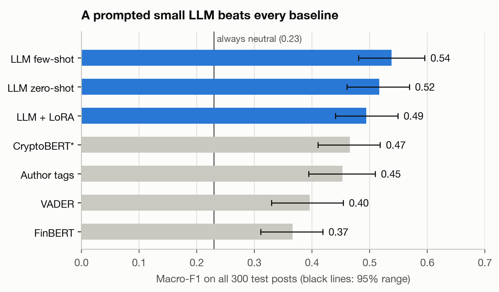
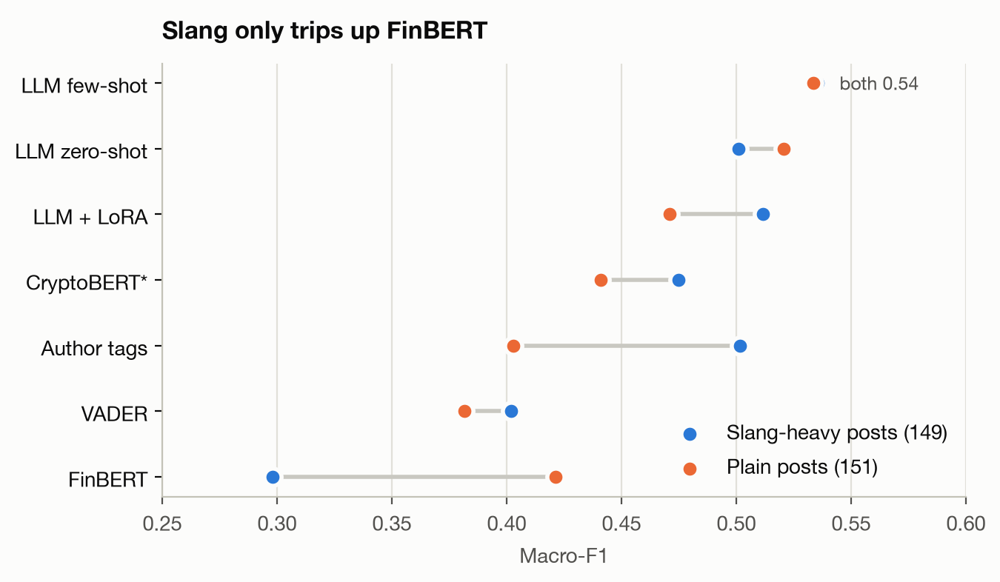

# SlangSense

**Fine-tuning small open-weight LLMs to read crypto sentiment and slang.**

Can a small, fine-tuned LLM read crypto slang better than standard sentiment tools?

Crypto social media has its own language: *HODL*, *FUD*, *rekt*, *WAGMI*, *rug pull*, *diamond hands*. General-purpose sentiment tools often misread it. This project fine-tunes a small open-weight language model (1–3B parameters) with LoRA to classify crypto posts as **bullish**, **bearish**, or **neutral**, and measures whether it beats general, finance, and crypto-specific baselines, especially on slang-heavy posts.

> DATA 575 (AI as Data Science: NLP to LLM), Gonzaga University · Final project

---

## Research question

Does LoRA fine-tuning a small open-weight LLM on crypto posts improve sentiment classification over:

1. a general rule-based tool (**VADER**),
2. a finance-domain model (**FinBERT**),
3. a crypto-domain model (**CryptoBERT**), and
4. the same LLM with **zero-shot** and **few-shot** prompting?

And does the gap change between **slang-heavy** and **plain** posts?

---

## Approach

| Model | Type | Role |
|---|---|---|
| VADER | Rule-based lexicon | General baseline |
| FinBERT | BERT fine-tuned on financial text | Finance baseline |
| CryptoBERT | BERTweet fine-tuned on crypto posts | Crypto baseline |
| LLM, zero-shot | Small instruct LLM, prompt only | Prompting baseline |
| LLM, few-shot | Same LLM + labeled examples in the prompt | Prompting baseline |
| **LLM + LoRA** | Same LLM, fine-tuned with (Q)LoRA | **Main model** |

Every model writes its predictions in the same format, and a single evaluation script scores all of them on the same hand-labeled test set.

```
StockTwits crypto posts
        │
   Data prep ──► train / val / held-out pool
        │
   Hand-labeled test set (300 posts, half slang-heavy)
        │
   ┌────────┬─────────┬────────────┬──────────────┬────────────┐
 VADER   FinBERT  CryptoBERT  LLM zero/few-shot  LLM + LoRA
   └────────┴─────────┴────────────┴──────────────┴────────────┘
        │
   One evaluation script ──► metrics, slang vs plain, error analysis
```

---

## Data

- **Training data:** [`ElKulako/stocktwits-crypto`](https://huggingface.co/datasets/ElKulako/stocktwits-crypto), 1.33M StockTwits crypto posts (Nov 2021 – Jun 2022), MIT license. The labels are the authors' own tags: **bullish** or **bearish**, plus **neutral** for posts the author left untagged ([source](https://huggingface.co/datasets/ElKulako/stocktwits-crypto/discussions/3)). After removing duplicates, balanced samples are drawn for training (30k posts) and validation (3k).
- **Slang:** [`data/slang.csv`](data/slang.csv) lists 118 crypto slang terms (*hodl*, *fud*, *rekt*, *wagmi*, *diamond hands*, ...) with their meanings. About 7% of all posts contain at least one.
- **Test set:** 300 posts from a separate held-out pool, labeled by hand without seeing the author tags: 149 slang-heavy and 151 plain, with 79 bullish, 62 bearish and 159 neutral. Slang is oversampled on purpose, so results are reported for each group separately. The author's tag is kept for comparison.
- **Known caveats:**
  - Author tags are noisy, and "neutral" really means "untagged", so models trained on these tags learn that noise. The hand-labeled test set measures real sentiment instead.
  - CryptoBERT was fine-tuned on posts from the same StockTwits dataset, so its scores may be optimistic.
  - The dataset was lowercased, and cashtags, usernames and URLs were removed before release.
  - Half the test set is slang-heavy by design, far above the natural rate of about 7%, so a single combined score over-represents slang. That's why results are reported for each group.
  - The hand labels are 53% neutral (79 bullish, 62 bearish, 159 neutral). Bearish has only about 30 posts per group, so its per-group scores are noisy. Macro-F1 weights the three labels equally, so always guessing neutral scores only 0.23.
  - One person labeled the test set, and some short posts are hard to call without the price at the time.
  - With 300 test posts, each score's 95% range is about ±0.05, so smaller gaps between models are within noise.
  - The fine-tune's validation loss is measured against the author tags, so it shows how well the model learned those tags, not how well it reads sentiment.

---

## Evaluation

- Macro-F1 (primary) and per-class precision / recall / F1
- Confusion matrices
- Every metric reported separately for slang-heavy and plain posts
- How common slang is across the full dataset
- Agreement between authors' own tags and hand labels
- Invalid-output rate for the LLM (replies that aren't a valid label)
---

## Results

Macro-F1 on the 300 hand-labeled test posts (higher is better; always guessing neutral scores 0.23). The range in brackets is a 95% bootstrap range: how much the score could move with a different sample of 300 posts. The last column scores each model against the authors' own tags instead of the hand labels.

| Model | All posts (95% range) | Slang-heavy | Plain | vs. author tags |
|---|---|---|---|---|
| LLM few-shot | 0.54 (0.48 to 0.60) | 0.54 | 0.53 | 0.42 |
| LLM zero-shot | 0.52 (0.46 to 0.57) | 0.50 | 0.52 | 0.44 |
| **LLM + LoRA** (main model) | 0.49 (0.44 to 0.55) | 0.51 | 0.47 | 0.59 |
| CryptoBERT* | 0.47 (0.41 to 0.52) | 0.47 | 0.44 | 0.72 |
| Author tags (as a model) | 0.45 (0.39 to 0.51) | 0.50 | 0.40 | n/a |
| VADER | 0.40 (0.33 to 0.45) | 0.40 | 0.38 | 0.37 |
| FinBERT | 0.37 (0.31 to 0.42) | 0.30 | 0.42 | 0.27 |

\*Trained on posts from the same dataset, so likely optimistic. The LLM is Qwen2.5-1.5B-Instruct in every row, and none of its 900 replies was an invalid label. Full numbers, including per-label F1, are in [`results/metrics.csv`](results/metrics.csv).



**What the results show**

- **A prompted small LLM beats every baseline.** With no training at all, zero-shot and few-shot prompting beat CryptoBERT in 95% and 98% of bootstrap resamples, even though CryptoBERT was trained on 2 million posts from this dataset.
- **Fine-tuning on the author tags didn't help.** The LoRA fine-tune converged (validation loss fell from 0.89 to 0.23), but it scores within noise of both CryptoBERT and zero-shot. It learned to copy the author tags: scored against them, its macro-F1 rises from 0.44 (zero-shot) to 0.59 ([figure](results/figures/hand_vs_author_tags.png)).
- **The author tags are poor sentiment labels.** They match the hand labels on only 45% of posts, and about half the posts tagged bullish or bearish are neutral by hand. Label quality mattered more than training.
- **Slang isn't the hard part; neutral is.** Only FinBERT does clearly worse on slang. On average a post is missed by the same number of models in both groups, and 10 of the 13 posts every model misses are neutral by hand.



---

## Project structure

```
SlangSense/
├── data/          # processed splits, hand-labeled test set, slang list (raw data not committed)
├── notebooks/     # one notebook per stage
├── src/           # shared code: label mapping, LLM prompt and reply parser, evaluation
├── results/       # predictions, metrics, figures
└── README.md
```

---

## Getting started

Requires [uv](https://docs.astral.sh/uv/) and Python 3.11 (uv can install it for you).

```bash
git clone https://github.com/WKS-DS/SlangSense.git
cd SlangSense

# Optional: keeps the environment out of iCloud sync if the folder is on a synced Mac Desktop.
# Skip this line to use uv's default .venv folder.
export UV_PROJECT_ENVIRONMENT=venv.nosync

uv sync
```

Open the notebooks in VS Code, select the environment's Python (`venv.nosync` or `.venv`) as the kernel, and run them in order:

| Notebook | What it does | Runs on |
|---|---|---|
| `01_data_prep.ipynb` | Downloads and cleans the dataset; writes the train / val / test-pool splits | Mac, about 1 minute |
| `02_test_set.ipynb` | Flags crypto slang, measures how common it is, and draws the 300-post test set. After hand-labeling, checks the labels and writes `data/test_hand_labeled.csv` | Mac, under 1 minute |
| `03_baselines.ipynb` | Runs VADER, FinBERT and CryptoBERT on the test set, also scores the author tags, and compares them all with `src/evaluate.py` | Mac, about 1 minute (plus a one-time ~1 GB model download) |
| `04_llm_prompting.ipynb` | Asks Qwen2.5-1.5B-Instruct to label the test posts, zero-shot and few-shot, and scores both next to the baselines | Mac with Apple Silicon (GPU), about 6 minutes (plus a one-time ~3 GB model download) |
| `05_lora_finetune.ipynb` | Fine-tunes the same model on the 30k training posts with QLoRA, after two quick convergence tests, then labels and scores the test set | Google Colab with a GPU, about 1 hour on an L4 (a free T4 is slower) |
| `06_evaluation.ipynb` | Scores every model, estimates 95% ranges by bootstrapping, compares slang-heavy and plain posts and the author tags, and looks at the posts every model misses. Saves `results/metrics.csv` and the figures | Mac, under 1 minute |

Notebook 05 runs on Google Colab, not the Mac: open it with the *Open in Colab* button at its top. It is set up for the free T4 GPU; if none is available, pick another GPU under *Runtime → Change runtime type* (the L4 needs Colab Pro). It saves its outputs to Google Drive (`MyDrive/SlangSense/`). Copy the CSV files to `results/`, and `adapter_config.json` and `adapter_model.safetensors` from `lora_adapter/` to `models.nosync/lora_adapter/`.

---

## Future work

- **Cleaner training labels.** Relabel the training posts with a stronger model, using the same definitions as the hand-labeling guide, then fine-tune again. This would show whether the fine-tune falls short because of the labels or because of the method.
- **A second labeler** for the test set, to measure how often two people agree and to catch labeling slips.
- **A larger test set**, to narrow the 95% ranges enough to separate the top models.
- **Local hosting.** Run the fine-tuned model on a laptop and measure its speed (planned as an optional stage and skipped for time).

---

## Status

Complete.

---

## Acknowledgments

- Prof. Joe Dumoulin, DATA 575, Gonzaga University
- Dataset and CryptoBERT by [ElKulako](https://huggingface.co/ElKulako)
- VADER (Hutto & Gilbert, 2014) and FinBERT (Araci, 2019)
